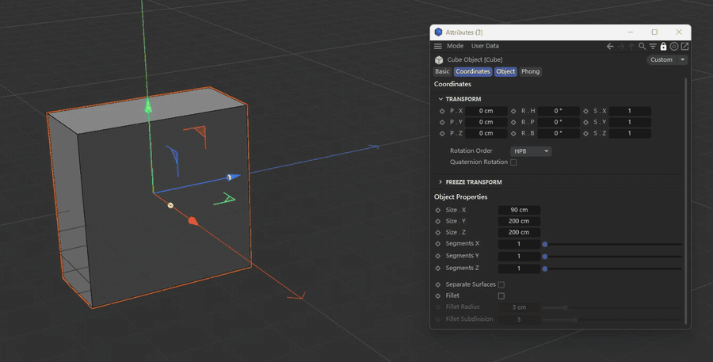

  

<h1 align="center">ValueLadder</h1>

  Houdini-style ladder value scrubbing for Cinema 4D

  <b>English</b> | <a href="README.zh-CN.md">简体中文</a>

  
   
  <a href="docs/media/demo.mp4">Full demo video (MP4)</a>

Hold the middle mouse button over any numeric field in the Attribute Manager, pick a step size on the ladder, and move left or right to change the value. Release to commit, right-click to cancel.

- Supports **Cinema 4D 2026 and 2027**, Windows only
- Free and open source, [MIT](LICENSE)
- Step-by-step guide and troubleshooting: [Help](docs/help.md)

## Install

1. Download `ValueLadder-1.0.0.zip` from [Releases](https://github.com/Aitidi/c4d-value-ladder/releases) and quit Cinema 4D.
2. Copy the `ValueLadder` folder from the ZIP into your plugins folder, e.g. `%APPDATA%\Maxon\Maxon Cinema 4D 2027_XXXXXXXX\plugins\ValueLadder` (or the matching `2026_XXXXXXXX` folder). Replace any older copy; do not keep two.
3. Start Cinema 4D. **Extensions → ValueLadder** shows the plugin.
4. **After the first install, enable the plugin:** open **Extensions → ValueLadder Settings...** (or **Edit → Preferences → ValueLadder**) and tick both **Enabled now (this session)** and **Enable at startup**.

## Use

| Action | Result |
| --- | --- |
| Hold **MMB** over a numeric field | The ladder opens next to the cursor |
| Move up or down the ladder | Picks the step: 1000 … 0.001 |
| Move left or right | Changes the value by one step every 6 px |
| Reach the screen edge | The pointer wraps around and keeps counting |
| Release **MMB** | Commits; the whole drag is one undo step |
| **Right-click** while holding | Cancels and restores the value |

- Integer parameters hide the fractional steps; time fields move in whole frames.
- Minimum and maximum limits of the parameter are respected.
- The ladder, its font and the pixels per step follow the monitor's DPI scaling.

## Where it works

**Works on:** objects, tags (including tags shown inside an object, e.g. Phong Angle), materials and shaders, user data, project settings, render settings and effects, the active tool, viewport settings, takes, layers, XPresso nodes, field layers, selected keyframes, node-material ports (Redshift and others), Scene Nodes input ports (including vector rows such as `Point [x] [y] [z]`) and the Preferences window. Redshift Camera is covered in detail: [Redshift Camera coverage](docs/redshift-camera-coverage.md).

**Not supported:** colour fields, gradients, splines, check boxes and drop-downs; node ports with an incoming connection; the Structure Manager, Picture Viewer and Render Queue. A field without a parameter label next to it shows a status-bar message instead of the ladder.

**Undo:** object, tag and material changes and node ports are one undo step each. Project settings such as FPS are not covered by Cinema 4D's undo: right-click still restores them during the drag, but a committed change cannot be undone with Ctrl+Z.

## Settings

Open **Extensions → ValueLadder Settings...** or **Edit → Preferences → ValueLadder**.

| Setting | Meaning |
| --- | --- |
| Enabled now (this session) | Turns the ladder on or off until Cinema 4D quits. **Extensions → ValueLadder** does the same. |
| Enable at startup | Whether the ladder is on when Cinema 4D starts |
| Ladder steps | Which of 10000 … 0.0001 the ladder shows (default 1000 … 0.001). A gesture starts on the step closest to 1. |

## How it works

Cinema 4D draws all Attribute Manager fields into a single window and offers no API that maps the mouse position to a parameter. Every parameter label, however, is a drag source that carries the parameter's exact `DescID` and the edited objects. On MMB, ValueLadder finds the field by its theme colour, locates its label, drags that label a few pixels into an invisible receiver window and refuses the drop. This takes about 130 ms and changes nothing. From then on the value is read and written through the regular parameter APIs, for node ports through the graph API.

## Development

| File | Purpose |
| --- | --- |
| `plugin/ValueLadder/ValueLadder.pyp` | The plugin |
| `tools/dev_reload.py` | Hot-reloads the plugin into a running Cinema 4D; a floating **ValueLadder dev** panel controls the test instance |
| `tools/build_release.py` | Builds and verifies the release ZIP |
| `tools/check_api_compat.py` | Run with a build's `c4dpy` to check that it has every `c4d` / `maxon` name the plugin uses |
| `tools/test_*.py` | SDK checks run inside Cinema 4D on disposable documents and copies |

Set the environment variable `VALUELADDER_DEBUG=1` to log to `%TEMP%\valueladder_debug.log`.

Plugin IDs 1072634, 1072637, 1072639 and 1072640 are registered with Maxon.

## Credits

The icon is drawn after the [Boghma Icon Template for Cinema 4D Plugin](https://www.figma.com/community/file/1653314126929745043/boghma-icon-template-for-cinema-4d-plugin) by DunHouGo (CC BY 4.0). Source: `docs/icon/valueladder.svg`.

## License

[MIT](LICENSE)
