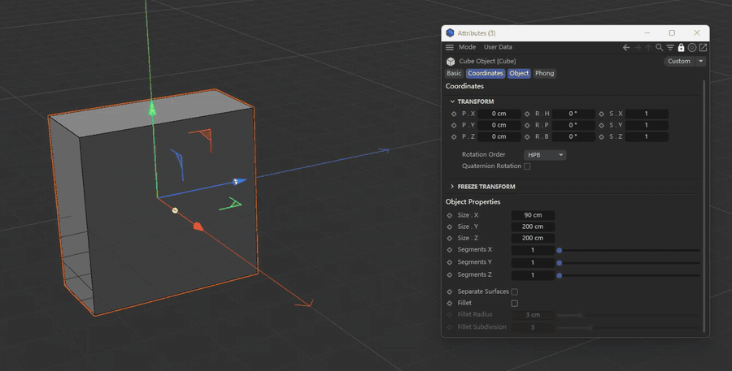

  

<h1 align="center">ValueLadder</h1>

  把 Houdini 的中键阶梯调值带到 Cinema 4D

  <a href="README.md">English</a> | <b>简体中文</b>

  
   
  <a href="docs/media/demo.mp4">完整演示视频（MP4）</a>

在属性管理器的任意数值框上按住鼠标中键，在弹出的阶梯上选择步长，左右移动即可改值。松开确认，右键取消。

- 支持 **Cinema 4D 2026 和 2027**，仅限 Windows
- 免费开源，[MIT](LICENSE) 许可
- 详细使用步骤与常见问题：[帮助文档](docs/help.zh-CN.md)

## 安装

1. 从 [Releases](https://github.com/Aitidi/c4d-value-ladder/releases) 下载 `ValueLadder-1.0.0.zip`，先退出 C4D。
2. 把压缩包中的 `ValueLadder` 文件夹复制到 plugins 目录，例如 `%APPDATA%\Maxon\Maxon Cinema 4D 2027_XXXXXXXX\plugins\ValueLadder`（2026 对应 `2026_XXXXXXXX` 文件夹）。替换旧版，不要同时保留两份。
3. 启动 C4D，**扩展 → ValueLadder** 中可以看到插件。
4. **初次安装后请先启用插件**：打开 **扩展 → ValueLadder Settings...**（或 **编辑 → 偏好设置 → ValueLadder**），勾选 **当前启用（本次会话）** 和 **启动时启用**。

## 用法

| 操作 | 效果 |
| --- | --- |
| 在数值框上按住**中键** | 光标旁弹出阶梯 |
| 在阶梯上上下移动 | 选择步长：1000 … 0.001 |
| 左右移动 | 每 6 像素改变一个步长 |
| 移到屏幕边缘 | 光标从另一侧绕回，继续累加 |
| 松开**中键** | 确认，整个拖动只占一步撤销 |
| 按住时点击**右键** | 取消并恢复原值 |

- 整数参数自动隐藏小数挡位；时间参数按整帧调整。
- 遵守参数自身的最小值、最大值。
- 阶梯尺寸、字体和每步像素随显示器 DPI 缩放。

## 支持范围

**支持**：对象、标签（含对象属性中内嵌的标签页，如 Phong 角度）、材质与着色器、用户数据、工程设置、渲染设置与效果、当前工具、视图设置、Take、图层、XPresso 节点、域图层、选中的关键帧、节点材质端口（Redshift 等）、场景节点输入端口（含 `Point [x] [y] [z]` 这类向量行）以及偏好设置窗口。Redshift 相机的详细覆盖见 [Redshift Camera coverage](docs/redshift-camera-coverage.md)（英文）。

**不支持**：颜色、渐变、样条、复选框和下拉菜单；已有输入连线的节点端口；结构管理器、图片查看器和渲染队列。旁边没有参数名称标签的数值框不弹出阶梯，只在状态栏提示。

**撤销**：对象、标签、材质参数和节点端口每次拖动为一步撤销。帧率等工程设置不在 C4D 的撤销范围内：拖动中右键仍可恢复，但确认后无法用 Ctrl+Z 撤销。

## 设置

打开 **扩展 → ValueLadder Settings...** 或 **编辑 → 偏好设置 → ValueLadder**。

| 设置 | 说明 |
| --- | --- |
| 当前启用（本次会话） | 仅在本次运行中开关阶梯，**扩展 → ValueLadder** 效果相同 |
| 启动时启用 | 启动 C4D 时是否开启 |
| 阶梯挡位 | 阶梯显示 10000 … 0.0001 中的哪些步长（默认 1000 … 0.001），每次从最接近 1 的挡位开始 |

## 原理

C4D 把属性管理器的所有控件画在同一个窗口里，也没有把鼠标位置换算成参数的接口。但每个参数的名称标签都是拖放源，携带参数精确的 `DescID` 和正在编辑的对象。按下中键后，插件按主题颜色找到数值框，再找到它的标签，把标签拖动几个像素到一个不可见的接收窗口并拒绝放下。整个过程约 130 毫秒，不修改任何数据。之后通过常规参数接口读写数值，节点端口则通过节点图接口。

## 开发

| 文件 | 用途 |
| --- | --- |
| `plugin/ValueLadder/ValueLadder.pyp` | 插件本体 |
| `tools/dev_reload.py` | 在运行中的 C4D 内热加载，由浮动的 **ValueLadder dev** 面板控制测试实例 |
| `tools/build_release.py` | 生成并校验发布包 |
| `tools/check_api_compat.py` | 用某版本的 `c4dpy` 运行，检查插件用到的 `c4d` / `maxon` 接口是否都存在 |
| `tools/test_*.py` | 在 C4D 内用临时文档和副本运行的 SDK 检查 |

设置环境变量 `VALUELADDER_DEBUG=1` 可把日志写入 `%TEMP%\valueladder_debug.log`。

插件 ID 1072634、1072637、1072639、1072640 均由 Maxon 正式分配。

## 致谢

图标参照 DunHouGo 的 [Boghma Icon Template for Cinema 4D Plugin](https://www.figma.com/community/file/1653314126929745043/boghma-icon-template-for-cinema-4d-plugin)（CC BY 4.0）绘制，源文件为 `docs/icon/valueladder.svg`。

## 许可

[MIT](LICENSE)
